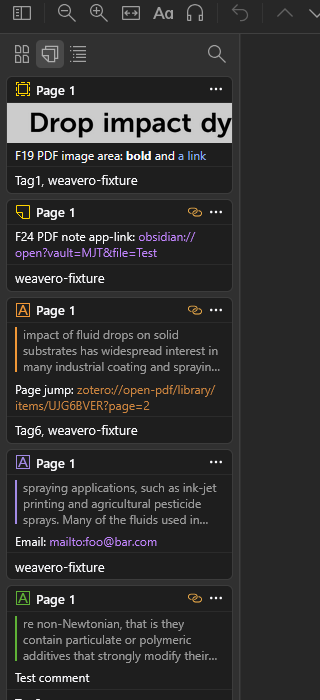
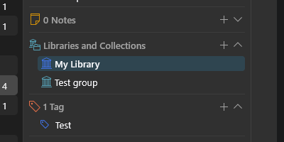
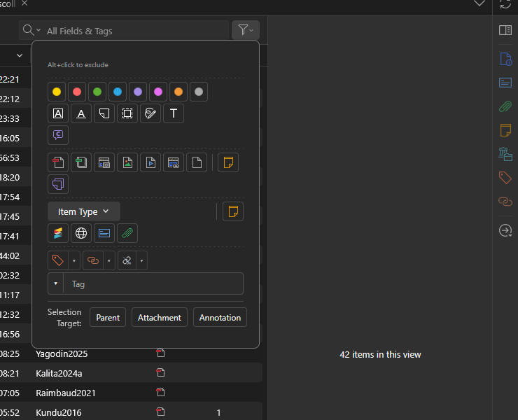
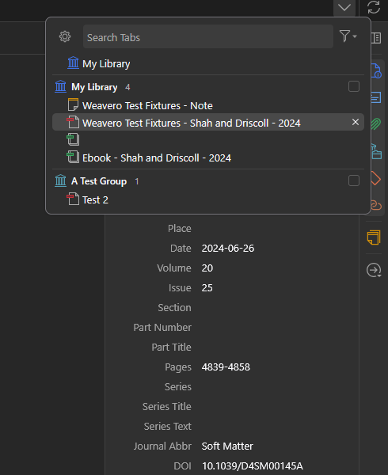
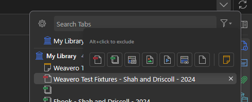
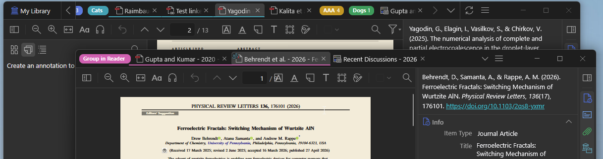
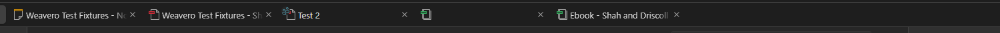

<h1>
  
  Weavero
</h1>

[](https://www.zotero.org)
[](https://www.zotero.org/support/dev/zotero_11_for_developers/)
[](https://github.com/mjthoraval/Weavero/actions/workflows/test.yml)

[](https://github.com/mjthoraval/Weavero/releases/latest)
[](https://github.com/mjthoraval/Weavero/releases)
[](LICENSE)

A Zotero 7 to 11 plugin that layers convenience features on top of the standard library and reader: clickable links in annotation comments and notes, a fast filter pane, bookmarks, related-item tools, a structured tabs menu, tab and window management, and extra items-tree columns. Everything is individually toggleable in Preferences.

> [!NOTE]
> **Your documents are safe.** Weavero never writes to or modifies your PDF files or attachments on disk — there's no risk of corrupting your documents. It only layers UI on top of Zotero's standard views and keeps its own data (bookmarks, preferences) in separate files. Any feature you turn off is inert.

> [!WARNING]
> **Weavero is under active development — please report anything that misbehaves** ([open an issue](https://github.com/mjthoraval/Weavero/issues)). A few things to know:
>
> - **Built on Zotero's internals.** Weavero hooks deep into Zotero's reader, items tree, tabs menu, and preferences, and is developed on the **Zotero 11 beta** and tested there and on Zotero 10.0. A Zotero update (beta or stable) can temporarily break a feature until the plugin catches up.
> - **Bookmarks are local-only.** The Bookmarks feature stores its data in `<Zotero data dir>/weavero/bookmarks.json`. Bookmarks are **not synced** across computers and are **not included in Zotero's cloud backup** — they won't appear on your other devices, and they're lost if you start a fresh profile or lose that folder. **Back up your Zotero data directory if your bookmarks matter to you.** (The Zotero developers have said they intend to add plugin-managed synced storage; Weavero will adopt it once it's available.)
> - **Some features need Zotero 10.** A few rely on Zotero 10 APIs and may be unavailable or behave differently on Zotero 9.

## Features at a glance

Grouped the same way as the Preferences tabs. Expand a group below for the details and screenshots.

- **[Enhanced links and relations](#enhanced-links-and-relations)** — clickable links (URLs, `zotero://`, 17 optional app schemes) in comments and notes; inline or icon + popup, colour-coded, with markdown; copy `zotero://` links for items / collections / searches / reader page / location / selection; Ctrl/Shift+click navigation through internal document links (into a split pane or a second window); related-item tools (*Add Related…*, chain badge, *Open Related* submenu, Related column, linked-library highlight).
- **[Filters](#filters)** — items-tree filter popup (annotation colour/type/comment, attachment & item type, *Has DOI/URL/Related/Links/Weavero Outline*, multi-select tag/publication/author/added-by/collection/search) with a removable chip bar; reader annotation filter; Selection Target tri-state; structured tabs menu with per-library and file-type filters.
- **[Bookmarks](#bookmarks)** — library bookmarks (items / collections / searches / URLs) via a toolbar dropdown; document bookmarks (in-PDF positions, pages, selected text, annotations) in a reader-sidebar tab, foldered and draggable, with search + funnel filter and hover cards; auto-hide when empty.
- **[Reader outline](#reader-outline)** — an editable Outline tab: rename entries, add your own (selected text, page anchors, pinned spots), reorder and nest by drag, switch between the document's original outline and your curated copy — and a **current-section highlight** that follows your reading position.
- **[Notes](#notes)** — an outline panel beside a note that marks the section you are reading; fold arrows on headings; links to a heading (*Copy Select Link to Heading* / *Copy Open Link to Heading*) and open links for notes, in Better Notes' form.
- **[Tabs and Windows](#tabs-and-windows)** — pinned tabs (Firefox-style, icon-only); named, colour-coded **tab groups** (collapse, drag-into, reopen, move between windows); **tab sessions** (save and switch whole workspaces); multi-select tabs; **move or tear-off a reader tab to another window with no reload** (scroll, zoom and selection preserved); **multi-tab reader windows** with their own tab strip and a Firefox-style **+** button; full drag-and-drop tab management in the "List all tabs" popup; reopen the last closed window/group; an item-details pane beside the reader in separate windows; and optional multiple main windows. Ready for the windows and library tabs Zotero 11 brings itself.
- **[Default attachment](#default-attachment)** — choose which child an item opens: any attachment (PDF or not), a linked URL, or a child note. Stored as a tag, so the choice syncs and survives without the plugin.
- **[Extras](#extras)** — items-tree columns (annotation, related, tag counts); *Added By* for annotations with per-user colours; group-library tab glyph; Hide title bar (Firefox-style); *Open in External Viewer*; a searchable **Plugins Manager** with richer plugin cards; *PDF outline text highlight*.

## Features

<details id="enhanced-links-and-relations">
<summary><b>Enhanced links and relations</b></summary>

**Clickable links in annotation comments** across the items tree, right item pane, reader sidebar, in-PDF popup, link badges over annotation icons, and notes. Each surface is independently toggleable. Out of the box `https://`, `http://`, and `zotero://` are recognised; seventeen extra schemes (`mailto:`, `obsidian://`, `vscode://`, `slack://`, `notion://`, …) can be toggled per-scheme.

- **Two display modes:**
  - **Inline** — URLs, markdown, and app links render directly in the comment; an icon opens a popup with the full formatted view when the row is clipped.
  - **Icon & Popup** — comments stay plain text; an icon next to each annotation opens the popup. Per-content-type sub-toggles for URLs / markdown / app-links.
- **Three colour buckets** so each kind of link reads at a glance: blue for `http(s)`, orange for `zotero://`, purple for app-scheme links.
- **Inline markdown** — `**bold**`, `*italic*`, `~~strike~~`, `` `code` ``, `[label](url)`.
- **App-link skip-confirm** — optional opt-in that bypasses Firefox's *"Allow this site to open the … link?"* prompt.
- **Right-click "Copy Link"** on any rendered URL.

<div align="center"></div>

**Copy `zotero://` links** (right-click menus). All are standard `zotero://open` / `zotero://select` links — they work without the plugin and from other apps.

- *Items list* — **Copy Item Link** (`zotero://select/.../items/<key>`; multi-select joins with newlines).
- *Collections tree* — **Copy Collection Link** / **Copy Saved Search Link**.
- *Reader (right-click on the page)* — **Copy Link to This Page** in a PDF (`zotero://open/.../items/<key>?page=N`, N = the page you clicked, even in spread / continuous-scroll layouts), or **Copy Link to This Location** in an EPUB / web snapshot (`?cfi=…` / `?sel=…` for the element under the cursor). With text selected it becomes **Copy Link to Selected Text** — for EPUB / snapshots that's a `?cfi=`/`?sel=` link to the exact passage; for PDFs it stays page-level (no `?rects=` URL form exists yet — [zotero/zotero#4508](https://github.com/zotero/zotero/issues/4508)).
- The `zotero://` URI handler also resolves `…/collections/<key>` and `…/searches/<key>` paths (group-library variants supported), `?cfi=` / `?sel=` location params, and `…/items?itemKey=K1,K2` multi-select, and switches focus to the library tab when followed from a note.

#### Interlinked navigation

<kbd>Ctrl/Cmd</kbd>-click or <kbd>Shift</kbd>+click an *internal* link to follow it without losing your place. Internal links include PDF cross-references and citations, EPUB section links, and web-snapshot `#fragment` links (external `http(s)` links are left alone).

- **<kbd>Ctrl/Cmd</kbd>+click → split pane** — opens (or reuses) a split and sends the target to the *other* pane, so the pane you clicked from stays put; a reverse Ctrl+click from the second pane drives the first. Split orientation (horizontal / vertical) is configurable.
- **<kbd>Shift</kbd>+click → duplicate window** — opens (or reuses) a second reader window of the same document and sends the target there; the two windows stay coupled both ways — handy across monitors.
- The target is highlighted **in place** (no scroll-to-top, no flash); a page reference with no text region gets a brief red locator dot instead.

Built on Zotero's own reader ([`zotero/reader`](https://github.com/zotero/reader), AGPL-3.0); it implements an idea first raised in [this 2022 forum request](https://forums.zotero.org/discussion/100095) for interconnected split views and reader windows.

**Related and linked items** — features built around Zotero's related-items relations (`dc:relation`) and the linked-items mechanism.

- **Add Related…** in the items-list right-click menu — opens Zotero's select-items dialog and links the chosen items as `dc:relation` peers (multi-annotation aware).
- **Chain badge** on annotation rows that have related items; click it for a popup listing the relations.
- **Open Related Item** submenu in the reader's annotation context menu (Open in Reader / In New Window per related item).
- **Related column** (items tree, icon-only) — count of related items per row.
- **Related hover card** — rest on (or Tab to) a Related row — Zotero's own, a widened part's, a count popup's — for a card showing both ends of the relation, each with its lineage (paper › file › annotation, with the annotation's text and comment), so you can tell which paper an annotation, a file or a note belongs to. A paper (or file) both ends share is drawn once, at the card's top — in the Item Links and Backlinks cards too.
- **Backlinks** — a *Backlinks* section in the item pane lists what points at the selected item from elsewhere: annotation comments and notes carrying a `zotero://` link to it, and notes where Zotero itself cites it (*Citation p. 7*) or quotes one of its annotations (*Quoted annotation p. 12*), each marked with its label. The item's own come first (like the Related section). Each row is the note or annotation that links it, shown as the Related section shows an item (its icon and title, a link in it clickable and in its colour), with a citation's page or a page of a file after it (*p. 7*). Each group comes under a heading drawn as the Tags and Related sections draw theirs (*This item*, then each attachment, annotation or note, with its icon and its count), even when the item's own rows are all there is, each row starting with an arrow pointing up to it, in the Zotero links' colour for a Zotero link. The sources follow the papers they come from, sorted by title. Rest the pointer on a row, or move to it with the keyboard, for a card with the whole paragraph around the link (the rows themselves stay compact in the item pane; the count popups group them under the paper and the note or annotation, on a guide line like the collections pane's, and show two lines of it on each row). Those aimed at its attachments, notes and annotations are counted beside the header's title, its attachments, notes and annotations apart, each by its icon, and listed after the item's own, part by part, as those counts filter them (see *What a section lists* below), each naming on its second line the part it lands on. Those counts also sit on the children themselves: a file's row in the *Attachments* section shows how many links point at the file or its annotations, next to Zotero's annotation count, and in the reader an annotation's card, and its popup in the PDF, carry a Links button (what its comment links) and a Backlinks button (what links it) next to *Related*; click any of them for the list, laid out as an item's under a "This item" heading. Click a row (or press Enter) to open the note in a tab at that spot or the file at that annotation; Shift+click, a middle click or Shift+Enter opens it in a new window instead; arrow keys move between rows; right-click for *Show in Library*, *Copy Link* and *Add as Related*. With nothing to list the section is greyed, as Zotero's own are. It also shows in a reader tab's context pane (for the paper) and in a note tab's (for the note). Nothing is stored: the index is rebuilt from the notes at each start and follows every edit. A quote followed by Zotero's citation of its paper (what *Add Note from Annotations*, or a highlight dragged from the reader into a note, writes) is one reference, listed under the annotation it quotes, with the citation's page; a quote whose citation was hidden, or a citation on its own, counts alone. A reference between two parts of the same item is an internal link: a note's citations of its own paper, a `zotero://` link from a note to its own paper or a page of its PDF, an annotation linking another annotation of its file, a link copied into a note with a dragged annotation's comment. It counts like any other, in place; the header shows by the links icon with a U-turn how many of its count are internal (in the count popups each such row carries that icon too), and clicking that count shows only them, Alt+click hides them. A link from a note or an annotation to itself counts too, as an internal link. Each reference as written is its own row: a note that links a paper twice, or two pages of its PDF, gives two rows, each with its own words and page, and a click opens the note at that one.
- **Item Links** — the mirror of Backlinks: a *Item Links* section in the item pane, right above *Backlinks*, lists where the selected item links out. For a paper, the references written in its notes and in its PDF's annotation comments (the header counts both beside its title, by their icons, and filters by them: see *What a section lists* below): *Zotero links* (`zotero://` addresses) and *note citations* (the citations and annotations Zotero's note editor adds to a note); the hover card names each with what it does (*Zotero link — Open at page 1*, *Note citation — p. 7*, *Note citation — annotation p. 4*). They come notes first, then annotations in reading order, in the order they are written: under a heading for the note or annotation that carries them (drawn as the Tags and Related sections draw theirs, with its count), each link on its own line after an arrow pointing down to the item it points at (a paper, a file, an annotation, a note), each line showing its item as the Related section does (its icon and title, a link in it clickable and in its colour), with a citation's page, a page of a file or a Better Notes link's line or section after it (*p. 7*, *line 3*, as Better Notes shows it). For a note or an annotation, every row is written in it: its rows come under *This item*. A Zotero link's arrow is drawn in the Zotero links' colour, a note citation's in grey. The count popups group the rows under the note or annotation that carries them, on a guide line like the collections pane's; each popup row names the item it points at, with *→ PDF p. 5* or *→ annotation p. 4* when it points inside that item, and a row aimed at an annotation also shows that annotation's highlighted text, one line with a bar in its colour; the card on hover or keyboard focus shows the words around the reference and describes the target (a paper's authors and year, an annotation's colour, text and comment, a note's first lines). The same card opens where the reference is written: rest the pointer on a `zotero://` link, a citation or a quote in a note's editor, or on a `zotero://` link in an annotation comment in the reader's sidebar or in the items list. Click a row (or press Enter) to follow it — a note opens in a tab; Shift+click, a middle click or Shift+Enter opens a new window; right-click for *Show in Library*, *Copy Link*, *Show in Source* and *Add as Related*. A quote and the citation after it are one reference, and references between two parts of the same item, a note's citations of its own paper included, count as internal links (see *Backlinks*). A link whose item is gone, or whose group library is not in this profile, is not counted: the header counts them apart, at the end of its line, by the links icon with an × in red, and each is listed greyed in its place, with the reason; click that count to see only them, Alt+click to hide them (whether they show in a new window is set in Settings). It comes back on its own when such an item lands. Only references to Zotero items count — a web URL is the *Has External Link* filter's business; the *Has Item Links* filter finds the items whose Item Links column would show a number. Every Link is the same entry its target's Backlinks section lists.
- **What a section lists** — the item pane's *Tags*, *Related*, *Item Links* and *Backlinks* sections count, beside their title, the item's own entries (by the item's type icon) and what its attachments, notes and annotations have, each by Zotero's icon for it (a paperclip, a note, the annotations' icon; hover one for what it counts), a level with none left out; *Item Links* counts by where a link is written (its notes, its annotations). These add up to the title, which counts the whole item's. At the other end of the title's line, *Item Links* and *Backlinks* count what does not add up to it: the Zotero links (the links icon with a Z) and the note citations (the links icon with a closing quote mark) when both are there, the internal links (the links icon with a U-turn), and in *Item Links* the broken links (the links icon with an ×). These counts filter the section as the items list's filter does: click one to show only those (two clicked: either), Alt+click to hide them, the same gesture again to clear. A filter stays while you move between items, in each main window; a new window, and every window after a restart, starts from the defaults set in Settings (*Links & Relations*, *Relations*: by default *Tags*, *Related* and *Backlinks* show the item's own only, *Item Links* everything). *Tags* and *Related* keep Zotero's own list at the top, editable as ever, under a "This item" heading while parts are listed, and add under it one heading per attachment, annotation and note that has any, with its tags or related items hung under it on a guide line (as in the count popups); filtered out, Zotero's own list is set aside. Click a heading, or one of its tags, to go to that attachment, note or annotation (an annotation opens in the reader); click a related item to open it, as in the Related section. Settings → *Relations & linked items* turns these counts and lists off in *Tags* and *Related*, which are then as Zotero draws them; *Item Links* and *Backlinks* each have their own switch, which also covers their hover cards.
- **Linked-libraries highlight** — when an item is replicated across libraries (linked items), the row matching the displayed item's library gets an accent background in the item pane's *Libraries and Collections* section.

<div align="center"></div>

</details>

<details id="filters">
<summary><b>Filters</b></summary>

**Filter popup** — a toolbar funnel `▼` next to the search box opens a compact filter panel; an accent dot marks the button while any filter is active. Click a facet to include, **Alt+click to exclude**. Filtering stays interactive on multi-ten-thousand-item libraries — a filter applies as fast as or faster than Zotero's own quick-search narrows; measured timings for all 39 filter configurations, the native comparison, and the methodology are in [`bench/`](bench/README.md).

- Annotation **colour**, **type**, **has-comment**
- **Attachment file type** — PDF / EPUB / Snapshot / Image / Video / Web Link / Linked File / Other File
- **Item Type** (native menulist + icon-only chips for the types you use), plus **Standalone Note** and **Standalone Attachment** tiles
- **Parent flags**: *Has DOI*, *Has URL*, *Has Abstract*, *Has Attachment File*
- **Retracted** — only the items that carry Zotero's red retraction mark in the items list (Alt+click: hide them), within any collection or search
- **Attachment / annotation flags**: *Has Bookmarks* (Weavero document bookmarks), *Has Annotations*, *Item Note*
- **Cross-level**, each with a ▾ *Apply to* scope: *Has Tag* and *Has Related* (parent / attachment / note / annotation); *Has External Link* (a link that leaves Zotero — `https://`, `mailto:`, an app link — in a comment or note; a `zotero://` link is *Has Item Links*'s), scoped by where it is written (standalone note / item note / annotation comment); *Has Item Links* (a comment or note links another Zotero item — Zotero links and note citations: what the *Item Links* section and column count), scoped the same way; *Has Backlinks* (linked from another comment or note), scoped by what is linked (the item / its attachments / notes / annotations). The two link chips never overlap: put them in two OR groups to find any link at all
- **Multi-select search**: Tag, Publication / Journal (exact match — case matters), Author / Creator, Added By (group libraries), Collection, Saved Search; ranked matching (typing *jfm* finds *Journal of Fluid Mechanics*) with keyboard navigation (↑/↓ + Enter), and selections shown as include/exclude pills like Zotero's tag selector. Collections are listed as an indented tree you can expand, like the collections pane. Several picked tags, authors, collections or saved searches must **all** match (an item in every picked collection); publications and Added By, where an item has only one value, match **any** of the picks
- **Selection Target**: Parent / Attachment / Annotation tri-state — controls Ctrl+A scope and dims out-of-scope rows
- Strict per-row matching: OR across groups, AND within a group; filtering keeps only rows that match — ancestors are kept for tree shape, descendants are not auto-pulled.

Active filters show as a **chip bar** above the items tree — one removable chip each, plus **+ Filter**, **+ OR Group**, and **Clear all**. A chevron on a container's first visible child reveals rows the filter hid, and a scope button inside the search box can restrict quick-search to chosen row kinds.

**Intersection of selected collections.** Select several collections or saved searches in the collections pane and Zotero lists every item in *any* of them. The **∩** button in the list's "N collections selected" header shows how many items are in *all* of them (**∩: 2**); click it to list only those, Alt+click for the items in some but not all, and click again to go back. It works per library, independently of the filter popup, and switches off when you go back to a single collection.

See [Filtering rules](docs/filter-rules.md) for the full logic.

<div align="center"></div>

**Reader annotation filter.** A funnel `▼` in the PDF / EPUB reader toolbar (next to *Find*) filters the open document's annotations by **type**, **colour**, **has-comment**, **tags**, **author**, and whether they have a tag, a related item, a link, **item links** (the comment links another Zotero item) or **backlinks** (linked from another comment or note) — matched-out annotations disappear from both the sidebar list and the page, and it works even with the sidebar collapsed. Alt+click a chip to exclude; an accent dot marks the funnel while filtering, and a *hide all annotations* checkbox is included.

**Annotation sort and dates.** Right-click the **Annotations** tab in the reader sidebar to sort that document's annotations by position, date added or date modified (or by hand, once you drag a card). Sorted by a date, each card shows both dates, the sorted one first. To see dates whatever the sort, tick **Date Added** and/or **Date Modified** under *Show on cards* in the same menu (that document only), or set them for every document in *Preferences → Weavero → Sort & Filters*. Hovering a card's header (or one of its dates) always shows both dates in full — Zotero's own tooltip there shows only the date modified. Annotations imported from a PDF made in another program carry the date Zotero imported them.

**Tabs menu.** The "List all tabs" dropdown gets a structured layout:

- **Library grouping** — section headers (themed library icon + name + tab count); the Library tab stays above all sections.
- **Per-library tickbox filter** — click to include, Alt+click to exclude. Hidden tabs disappear from the popup *and* from the main tab strip; the toolbar tabs-menu button picks up an accent tint while any filter is active.
- **File-type filter** (funnel button) — same theme-aware attachment icons as the items-tree filter (PDF / EPUB / Snapshot / Image / Video / Web Link / Other File), plus a yellow Note tile.
- **Settings** (gear button) — *Sort by Library* and *Show Annotations Count* toggles.

<div align="center">

&nbsp;

</div>

</details>

<details id="bookmarks">
<summary><b>Bookmarks</b></summary>

Bookmarks across two scopes. **Stored locally** in `<Zotero data dir>/weavero/bookmarks.json` — see the syncing/backup warning near the top of this page.

- **Library bookmarks** — a **Bookmarks dropdown** on the collections-pane toolbar for **items, collections, saved searches, whole libraries, and plain URLs**. Right-click a collection or library in the tree for **Bookmark Collection** / **Bookmark Library**. Quick access to the things you return to.
- **Document bookmarks** — a **Bookmarks tab in the reader sidebar** for **in-document locations**: a precise position (drops a 📌 pin you can drag to re-place), a whole page (PDF), a selected-text passage, or an annotation in the current document — plus an "Elsewhere in Zotero" section for items / collections / URLs and cross-document selections. Add them from the **+** button or the reader's right-click menu.
- **Library-bookmarks tab in the reader** (optional) — also browse your Library-scope bookmarks from the reader's Bookmarks panel; a scope toggle switches between *this document* and *library* (Ctrl-click to show both).
- **Folders &amp; drag-and-drop** — organise either list into folders and subfolders; reorder, nest (folders spring open on hover), and drag annotations, text selections, or items / collections / searches / libraries straight in.
- **Search &amp; filter** — each list has a search field and a **funnel** that filters by annotation type / colour / tags / author.
- **Rename, edit &amp; reset** — rename a bookmark (and edit its comment) without touching the source; *Reset to Original Name* restores the live label. Deleted targets show as dimmed, struck-through **orphans** with a ⚠ badge.
- **Hover card** — hovering a row shows a rich card: kind, colour swatch, page label, text preview, comment, tags, source document, and created date.
- **Auto-hide when empty** (optional, per scope) — hide the collections-pane button / reader tab until you add the first bookmark.
- **Undo** — every change to document bookmarks, library bookmarks and outline entries can be undone with Ctrl+Z / Ctrl+Shift+Z (Ctrl+Y on Windows), from **Edit → Undo**, and from the two **Undo / Redo arrows** in the reader toolbar after the annotation tools (as in Acrobat; right-click an arrow for the history), from anywhere in the reader tab: the page, the Outline tab or the Bookmarks tab. Each tab has one history: its outline, its bookmarks and the reader's own annotation undo are merged, whichever sidebar tab is showing, and the most recent action goes first — a bookmark you just added is undone before an older highlight, a highlight you just made before an older outline entry. An undone step is always shown: a collapsed sidebar reopens, switches to the step's pane and selects what came back. Right-click a toolbar arrow for the **History** menu: Undo / Redo with their shortcuts, then the 12 most recent steps. Hovering a row brackets in blue the steps that must go with it (later steps that touched the same entries, or newer annotation steps); clicking the row undoes exactly that group and leaves unrelated steps alone. To undo several groups at once, tick their boxes (or Ctrl+click the rows) and press **Undo N selected**. Once something has been undone, a **Redo history** list follows with the same controls. Histories last the current Zotero run and survive plugin updates. Related-item and annotation-comment edits made from Weavero go into Zotero's own undo instead (Edit → Undo in the main window, Zotero 10+).

</details>

<details id="reader-outline">
<summary><b>Reader outline</b></summary>

The reader's **Outline** tab becomes editable. Your edits are **stored locally** in `<Zotero data dir>/weavero/outlines.json` — see the syncing/backup warning near the top of this page; the document's own outline is never modified.

Works in **PDFs, EPUBs and web snapshots**: an EPUB's outline is its table of contents (scrolled and paginated layouts), a snapshot's is built from the page's headings.

- **Sources** — the document's **embedded** outline, the one **Zotero extracts** when a PDF has none, or your own **Weavero outline** (a curated copy, created on the first edit). A chip in the panel header switches between them. To start over, right-click the chip while the Weavero outline is shown, or the Weavero row of the chip's menu → *Delete Weavero Outline…* (asks for confirmation first; the document's own outline is not changed).
- **Edit** — rename entries (the target stays put, so renaming never changes where an entry goes), delete, reorder and re-indent by drag, expand/collapse all with `+` / `-`.
- **Add your own entries** — from selected text, a **page anchor** (top or bottom of a page), or a **pinned spot** you place in the document. Each kind carries its own glyph, and entries show their page number — something Zotero's own outline doesn't ([zotero/zotero#3752](https://github.com/zotero/zotero/issues/3752)). Don't want the page numbers? Right-click the **Outline** tab to hide them for that document, or turn them off for all documents in Preferences. The same menu lists **Expand All** / **Collapse All** with their shortcuts (double-click on the tab, `+` / `−`) and the outline text size. Added and deleted entries can be undone — see **Undo** under *Bookmarks* above: one history per reader tab, shared with the bookmarks and the reader's own annotation undo.
- **Keyboard shortcuts for adding entries** — none out of the box; in *Preferences → Weavero → Extras → Reader outline*, click a box and press the keys you want (any combination, a single letter too) for *Add selected text*, *Pin a spot*, *Top of page* or *Bottom of page*; *Remove* clears one. Combinations Zotero or the reader already use are refused, with their owner named. A shortcut works anywhere in a reader tab except while you type in a text field, and shows next to the matching menu items. With no text selected, *Add selected text* waits for you to select some.
- **Current-section highlight** — as you scroll, the entry for the section you're reading is marked. It works on all three sources, and on entries you added yourself. The tree is never expanded or collapsed for you: the marker sits on the deepest entry *visible in your tree*, and relocates the moment you expand a branch. Zotero's own reader has highlighting since 7.0.11; Weavero's Outline tab replaces the native view, so it brings its own — plus the immediate refresh after expanding that the native one still lacks ([forums #114157](https://forums.zotero.org/discussion/114157/how-to-locate-the-current-position-of-the-pdf-reader)).
- **…and it follows sections *within* a page.** Native tracking is page-granular — several headings on one page are indistinguishable, in Zotero as in Acrobat and Firefox's viewer. Weavero compares your reading position (a quarter down the view, the same place a click on an entry lands its target) against each heading's own height, so a page of short sections is followed one heading at a time. Where a PDF's embedded outline stores no real heading coordinates — some store only a page — that page falls back to the page-granular behaviour.
- **Reading Mode** — the outline stays available as a read-only lens, and Reading Mode's own generated outline is offered as an extra source.
- **Text size** — the outline follows Zotero's *View → Font Size*, like the rest of the reader. To make just the outline bigger, *Preferences → Weavero → Extras → Reader outline → Outline text size*: *Zotero Outline* (default) and *Zotero Item Pane* follow Font Size; *Fixed* (8 to 24 px) stays at the chosen size. Set it for all documents there, or right-click the **Outline** tab to pick a size for one document.

</details>

<details id="notes">
<summary><b>Notes</b></summary>

- **Outline beside a note** — a panel at the left of a note lists its headings and marks the section you are reading; click a heading to go there, or use the arrow keys as in the reader's outline; the magnifier in the panel's bar filters the list. Open in note tabs and note windows, closed in the item pane and beside a reader; the *Toggle Outline* button at the left end of the note's toolbar shows or hides it, in a note without headings too. With [Better Notes](https://github.com/windingwind/zotero-better-notes) installed it replaces Better Notes' left pane in note tabs; untick *Outline beside notes* to get that pane back. *Preferences → Weavero → Extras → Notes*.
- **Fold arrows on headings** — an arrow beside a heading hides everything under it, down to the next heading of the same or a higher level. Only the view changes: the note is untouched, and folds are remembered per note on this computer.
- **Links to notes and headings** — right-click a heading for *Copy Select Link to Heading* (selects the note and goes to the heading; without Weavero it still selects the note) or *Copy Open Link to Heading* (opens the note in a tab and lights the heading up). *Copy Open Link* on a note writes the note link Better Notes uses, so it opens with either plugin. The first link to a heading adds a small id to it, saved with the note and synced.

</details>

<details id="tabs-and-windows">
<summary><b>Tabs and Windows</b></summary>

Tab and window management on top of Zotero's tab bar. Each piece is individually toggleable.

- **Pinned tabs** — drag a tab into the pinned region (or *Pin Tab* in the tab right-click menu) for a Firefox-style, icon-only tab. Pins persist across restarts, never scroll out of view when the tab strip overflows, and clear automatically if the item is deleted.
- **Tab groups** — named, colour-coded groups on the tab bar: click to collapse/expand, hover to preview, right-click to rename, recolour, ungroup or close. Add tabs with the *Add Tab to Group ▸* submenu or by dragging; saved groups can be reopened from the "List all tabs" dropdown. **Groups move between windows as a whole**: drag the group's chip onto any other main or reader window (released anywhere on the target window) and every member travels with it; drag it onto the desktop to pop the group into its own new window.
- **Tab sessions** — the current workspace (every window and its tabs) is always kept in the current session, shown at the top of the "List all tabs" dropdown. *+ New session* opens a fresh, empty workspace while the one you were in stays in the list; clicking a saved session switches to it, and the one you leave keeps its tabs. Right-click a session to rename or delete it. The list shows the newest session first by default; the sort control on the *Sessions* header (the same dropdown-plus-arrow as the annotations pane) switches it to name or last-used order and flips the direction (remembered across restarts); sorting on a date shows it under each session, and a session's tooltip always carries when it was created and last used.
- **Multi-select tabs** — <kbd>Ctrl/Cmd</kbd>+click to toggle and <kbd>Shift</kbd>+click for a range, then move or close several tabs at once.
- **Move / tear-off reader tabs between windows** — drag a reader tab into another window, or use *Move to New Window*. For PDFs this is a **no-reload** move that preserves scroll position, zoom and text selection (other attachment types fall back to a reload); the tab keeps its identity.
- **Multi-tab reader windows** — a separate reader window gets its own tab strip: hold several documents and notes in one window, with a Firefox-style **+** button (opens Zotero's item picker to add a tab, sitting flush against the last tab) and its own "List all tabs" button. Reader windows and their tabs — including their groups — are restored on restart.
- **Drag-and-drop in the "List all tabs" popup** — reorder tabs, drag them between windows (main or reader) or into groups with a WYSIWYG drop preview, and drag a group's header row to move the whole group. Popup moves land **in the background**: the tab you're reading stays focused, and moved tabs arrive unloaded until you select them.
- **Reopen closed window / group** — <kbd>Ctrl/Cmd</kbd>+<kbd>Shift</kbd>+<kbd>T</kbd>, or the matching context-menu entry.
- **Item pane in separate reader windows** — a standalone reader window can show the same item-details pane as the main window (metadata, attachments, related, notes, tags, collections). Resizable, with the width remembered.
- **Multiple main windows** — open a new main window with <kbd>Ctrl</kbd>+<kbd>N</kbd> (<kbd>⌘N</kbd> on macOS) or *File → New Main Window* (the File menu of a reader window has it too; on Windows and Linux the hamburger menu carries the same three — *New Tab…*, *New Reader Window…*, *New Main Window* — as the File menu does); the items/attachment context menu also gains a *"New Window"* action to open the selected items in a fresh main window. Any collection, library or saved search opens in a new main window too: middle-click it, or right-click → *Open in New Window* (<kbd>Shift</kbd>+click and <kbd>Ctrl</kbd>+click keep Zotero's meaning: selecting several collections) — and the collection you were in stays put: a right-click opens the menu for the row under the pointer (a thin dashed outline marks it) without moving the selection or your items list — through the menu's action too, so a cancelled dialog leaves nothing changed, and a sub-collection you create or rename from that menu is outlined where it appears while you stay put (an empty collection is nothing to look at). One switch in *Settings → Weavero → Tabs and Windows → Multiple main windows* governs every route, Ctrl+N included. On Windows, Weavero also works around Zotero's occasional ghost of a context menu left on screen while a dialog opened from it is up.
- **Advanced Search in a new window** — *Edit → Advanced Search in New Window*, <kbd>Shift</kbd>+click or middle-click the Advanced Search funnel (Shift+click works on *Edit → Advanced Search* too), or right-click the funnel → *Open in New Window*. A second main window opens on your whole library with Advanced Search already open, so the first window keeps showing what you were looking at — at a modest size rather than the main window's (it remembers the size you give it), like the separate Advanced Search window of Zotero 9, and without the collections and item panes — the search and its results (a setting brings the panes back). Zotero's own shortcut, <kbd>Ctrl</kbd>+<kbd>Shift</kbd>+<kbd>F</kbd> (<kbd>⇧⌘F</kbd>), does it too — the old separate-window reflex, back (a switch under *Settings → Weavero → Tabs and Windows → Multiple main windows* returns the shortcut to Zotero's in-window search). Zotero 10 and 11 — Zotero 9's Advanced Search is already a separate window.
- **Zotero's own windows** — Zotero 11 is bringing several main windows and library tabs of its own ([zotero/zotero#6035](https://github.com/zotero/zotero/pull/6035)). On such a Zotero, Weavero leaves windows, tear-off and moves between windows to Zotero, and keeps its features in every window and library tab: on the first start, the windows Weavero saved open once as Zotero's own, with their tabs, collections, titles and hidden collections; saved windows, tab groups (moved with Zotero's own move), tab sessions, pinned tabs and the items-list filter work there. On Zotero 10 and the current Zotero 11 beta, nothing changes.

<div align="center"></div>

The "List all tabs" dropdown's library grouping and file-type filter live under [Filters](#filters) — that's the tabs *menu*; this group is tab *management*.

</details>

<details id="default-attachment">
<summary><b>Default attachment</b></summary>

Zotero decides what a double-click opens with a fixed rule: PDFs first, then an attachment whose URL matches the item's, then the oldest. If your main paper sits next to a supplement, an accepted manuscript and a data file, that rule often picks the wrong one.

**Right-click any child of an item → `▶️ Set as Default Attachment`.** The choice is *not* limited to PDFs — anything openable qualifies:

- file attachments, **PDF and non-PDF** (EPUB, HTML snapshot, image, …)
- **linked URLs**
- **child notes**

The same entry reads `▶️ Clear Default Attachment` once set, so one menu item does both. (Zotero itself has a pending native *Primary Attachment* feature, [zotero/zotero#3333](https://github.com/zotero/zotero/pull/3333); Weavero deliberately keeps the distinct *Default* name so the plugin tool and the future native feature stay tellable apart — and migrating from one to the other reads unambiguously. The problem's full history — a decade of upstream issues, the script lineage this feature descends from, and a critical audit of my own precursor script — is documented for review at [default-attachment](https://mjthoraval.github.io/Weavero/default-attachment).) Turning the feature off in *Settings → Weavero → Extras → Default attachment* stops the override but keeps your picks.

**How the choice is stored — and why it matters.** The pick is an automatic tag, `▶️ wv-defatt`, on the chosen child. That means it **syncs to your other devices**, it survives exporting, and it keeps working if you ever remove Weavero (the tag simply becomes an ordinary tag and Zotero returns to its own rule — nothing to repair). Deleting the child deletes the choice with it, so nothing is ever left dangling.

The leading `▶️` is rendered by Zotero in the items list, so a marked child is visible at a glance without spending one of your nine colour-tag slots.

**Seeing what opens.** The attachment that opens sits in the **first row** of an item's attachments (your chosen default, or Zotero's automatic pick when you haven't chosen), and the automatic pick carries a dimmed **▷** in the items list — so you can always see what would open if your chosen default were removed. All three behaviours have toggles in *Settings → Weavero → Extras → Default attachment* (on by default).

**Finding every marked item:** search **`wv-defatt`**, or the **`▶️`** glyph. The slug deliberately contains no ordinary words — searching `default` or `attachment` will *not* drag your marked items into unrelated results, which is exactly what a readable name would have done (Zotero's quick search matches substrings and splits on spaces).

> Only one child per item is ever marked: setting a new default clears the previous one. Marking is not treated as editing the item, so **Date Modified is left untouched** — a sweep of choices won't scramble a Date Modified sort.

### Coming from *Default Attachment* (PikaPei)

[PikaPei/zotero-default-attachment](https://github.com/PikaPei/zotero-default-attachment) does the PDF-only version of this. If Weavero finds picks saved by it, **it asks what you want to do** — it never imports them behind your back, because importing writes tags to your library and queues those items to sync:

| Choice | What happens |
|---|---|
| **Import into Weavero** | Its picks become `▶️ wv-defatt` tags. A choice you have already made in Weavero is never overwritten. |
| **Don't import** | Nothing is imported — for when you were only trying that plugin. |
| **Keep using Default Attachment** | Weavero's feature switches off and that plugin carries on exactly as before. |

The third option appears only when that plugin is actually running. The question stays until you answer it: closing the window or ignoring it brings it back next start, rather than quietly deciding for you.

**Weavero never writes to that plugin's data — on any path.** Its preference is read-only to Weavero, so nothing you do here can damage it, and *Keep using Default Attachment* always leaves you exactly where you started. Changed your mind? Turn Weavero's feature back on in *Settings → Weavero → Extras* and the offer to import returns.

While Weavero's feature is on, that plugin's duplicate **"Set Default"** entry is hidden, so the menu offers one action rather than two that behave differently. Switch Weavero's feature off and its entry comes straight back.

**Removing that plugin's leftover data (optional, manual).** All of its state is a single preference, so there is nothing to uninstall beyond the plugin itself:

1. *Settings → Advanced → Config Editor* (this opens `about:config`).
2. Search for `extensions.zotero.defaultattachment.mappings`.
3. Delete / reset that preference.

That preference is the plugin's **only** copy of those choices — it is not synced and has no backup — so this cannot be undone. Your Weavero defaults are tags on the attachments and are not affected.

**Being asked again.** You are asked once, the first time Weavero finds anything — so installing Weavero *before* the other plugin is fine, its picks are still noticed when they appear. Once you have answered *Import* or *Don't import*, Weavero stops asking; that is deliberate, since a choice you cleared in Weavero would otherwise come back from the old plugin's data on every restart. (*Keep using Default Attachment* is not a final answer — the offer returns whenever you re-enable the feature.) If you kept making picks with that plugin afterwards, reset `extensions.zotero.weavero.defaultChildMigrated` in the same Config Editor to be asked once more.

</details>

<details id="extras">
<summary><b>Extras</b></summary>

**Items-tree columns** (icon-only, hidden by default; enable via the column-picker right-click on the items-tree header; drag a separator to widen one, like Zotero's own Notes column):

- **Annotations** — count of annotations on attachments; sums across attachments on regular items.
- **Tags** — count of tags per row: manual tags (blue) and automatic tags (default colour). Toggle off the automatic count to show only the manual count. The Settings switch is the default; each main window can choose for itself from the header's right-click menu (**Tags › Automatic-Tag Count**, next to **Show Column**), and keeps that choice across restarts.
- **Related** — count of related items per row.
- **Backlinks** — count of the references to the row's item written in comments and notes elsewhere (each one written counts: a note linking it twice counts 2): collapsed, together with its children and their annotations; expanded, the item's own (as Tags and Related count). Annotation rows have no column cells, so a linked annotation shows a Backlinks icon at the end of its line instead (while the column is shown), and its card in the item pane carries the same button next to Related; click either to list what links there.
- **Item Links** — the mirror: count of the references to Zotero items written in the row's notes and annotation comments, Zotero links and note citations alike, each one written counting (collapsed, the whole subtree; expanded, the note's or annotation's own). An annotation that links other items shows a Links icon on its line instead (while the column is shown), just before its Backlinks icon, and the same button sits on its card in the item pane and in the reader. A broken link — its item gone, or in a group library not in this profile — is never counted; it is listed greyed in place, under the note or annotation it is written in, to be repaired, and a red broken-link count at the end of the section's header shows them alone (click) or hides them (Alt+click). A row or a heading that names an annotation (in Links, Backlinks, the Tags and Related part headings and the count popups) gives Zotero's title for it — its text and comment — then, in grey, its file and its page: "“are non-Newtonian…” Full Text PDF · p. 3". The page is the one the link names, else the annotation's own; short of room the file name is cut, never the page. The file is named once the item has more than one file Zotero can annotate (PDF, EPUB, web snapshot); a Word file or a spreadsheet beside the PDF does not count. A "→ annotation" chip reads "→ annotation p. 3 (Full Text PDF)".
- **External Links** — count of the web and app links written in the row's notes and annotation comments — what *Has External Link* finds — each link once (a link whose text repeats its address counts once), only the schemes switched on in Settings; collapsed, the whole subtree; expanded, the note's or annotation's own. A `zotero://` link is *Item Links*'s. Its number lists each link under the note or annotation it is written in, with the text around it; click one to open it.

Rest the pointer on a Backlinks or Links row (or Tab to it) for the full context card: the **source** — its paper, the file, the note or annotation (its highlighted text drawn as Zotero draws it, with a bar in its colour) — and the **target**, climbed the same way, or the address and the reason when the link is broken, side by side, with an arrow drawn from the note or annotation the link is written in to what it points at; under both, across the whole card, the reference itself with up to 600 characters of what comes before it; Esc closes it.

Click a number in the Tags, Related, Backlinks, Item Links or External Links column to list what it counts, grouped by where each entry sits (the item, an attachment, an annotation, a note): open the row and the number counts the item's own entries, collapse it and it counts the whole subtree. A related item or a backlink opens from the list (Shift+click or a middle click: in a new window); a tag filters the list by that tag. Ctrl/Shift+click keeps Zotero's multi-select.

**Group-library visuals:**

- **Added By for annotations** — in group libraries, a badge showing who created each annotation (annotation rows aren't covered by Zotero's built-in Added By column), optionally tinted with a **per-user colour** so contributors are easy to scan.
- **Group-library tab glyph + tooltip** — tabs whose item lives in a group library get a small "Group Libraries" cluster glyph on the file-type icon, plus a tooltip showing the tab title and a *library icon + Library Name* header.
- **Firefox-style tabs** — the tab design of Firefox 157: rounded tabs, round pinned tabs, and a thin violet-to-orange outline around the selected tab; when tabs get narrow, only the selected one keeps its close button, as in Firefox. On by default; uncheck it in *Preferences → Weavero → Extras → Items list & tabs* for Zotero's own tabs.

<div align="center"></div>

**Window and utility extras:**

- **Hide title bar (Firefox-style)** — replace the title bar with a browser-style bar (menus move out of the way, press <kbd>Alt</kbd> to summon them; window buttons move into the tab strip). Per-window-type sub-toggles (main window / separate reader window / separate note window / Plugins Manager). **Windows / Linux only; off by default.**
- **Open in External Viewer** — a right-click item that launches an item's best attachment with the OS default application (below *Show File* in the items list and *Show in Library* in the tab menu). Works for any stored file; the entry's icon mirrors the attachment type. *(Replaces the standalone "Open PDF for Zotero" plugin.)*
- **Titles on several lines** — the items list can wrap long titles. *Fixed height* makes every row as tall as the number of lines you set (2 to 10); *Fit each title* makes each row as tall as its title needs, up to that number. The other text columns wrap inside that height, and everything sits at the top of the row. Longer text ends in an ellipsis, and child rows stay on one line. Zotero's one-line list stays the default; *Preferences → Weavero → Extras → Items list & tabs*.
- **Collections pane toggle** — a collapse / expand button at the window's top-left that stays put when the pane goes, the twin of the item pane's and the reader's; *View → Layout → Collections Pane* keeps working. The collections search box, once open, takes a line of its own at the pane's full width. One switch in *Preferences → Weavero → Extras → Collections pane*.
- **Hide collections, saved searches and group libraries** — right-click a collection (or several), a saved search or a group library → *Hide …*; a hidden collection takes its sub-collections with it, and a collection whose sub-collections are all hidden loses its expand arrow. Zotero's special collections — *Unfiled Items*, *Duplicate Items*, *My Publications*, *Retracted Items*, *Recently Read* — hide the same way, per window: Zotero's own *Hide* on them is a setting for every window, which Weavero leaves alone; what that setting hides is listed too, marked *(all windows)*, and comes back through it. The Bin is never hidden. *My Library* itself can be hidden too, like a group library, as long as another library stays shown; the *Group Libraries* line brings it back. Whole sections go at once as well: right-click the *Group Libraries* heading → *Hide* (every group, groups you join later included; offered while *My Library* is shown), or the *Feeds* row → *Hide* (every feed); both come back from *My Library*'s *Show Hidden ▸* menu or the manager, where the heading and the *Feeds* row move across like any row. A single feed hides on its own too (right-click it → *Hide*): the *Feeds* row then carries the dot and *Show Hidden Feeds ▸*. Each main window keeps its own set, so two windows can show different parts of your library: a new window starts with everything shown, and the set travels with its window — back after a restart, after *Save & Close Window* and reopening, and per tab session (each session remembers its windows' sets). A blue dot at the end of the *My Library* (or group library) line, or of the *Group Libraries* line, says something is hidden; right-click that line → *Show Hidden Collections ▸* (in Zotero's Show group, each entry with its row's icon) / *Show Hidden Group Libraries ▸*: *Manage Hidden…* opens the *Collections and Libraries Manager*, a resizable window (named for its main window when several are open) with two of Zotero's own collection trees — what this window shows on the left, open and closed as the collections pane shows it, and what it hides on the right — with Zotero's *Filter Collections* box over both, and the collections pane's pinned parents (the *Keep parent collections pinned* setting) in both trees; rows that cannot move from where they are (the last library shown, the headings and library rows that only hold hidden entries) are in grey italics with a tooltip saying why, and cannot be selected; what a hidden collection, library or section hides with it can be selected, and *← Show* brings that holder back with it (the tooltip says so); <kbd>Ctrl</kbd>+<kbd>A</kbd> takes the rows of the selection's level as in the collections pane, saved searches and special collections included; a right-click offers Zotero's collection menu on the manager's own rows — *New Subcollection…*, *Rename* (inline, F2), *Move To ▸*, *Copy To ▸*, *Hide →* / *← Show*, *Delete Collection…* (the Delete key), *Export…* — and a collection keeps its expansion when it moves across. Drag and drop works as in the collections pane (a drop on a row moves the collection under it, a library row takes it back to the root; the target opens and the moved collection is selected there), with the pane deciding the rest: a drop on a row of the *Hidden* pane also hides the collection, one on a row of the *Shown* pane shows it, and a drop on a pane's free area hides or shows what you dragged — collections, saved searches and libraries alike. Select on either side (mouse or the collections tree's own keys) and press *Hide →* / *← Show* (or double-click, or Enter), or *← Show All* for everything at once — the window holds one selection, so selecting on one side clears the other and only that side's button is on; every move applies at once, and the window stays until you close it — or *Show All* in the menu, or one at a time. With nothing hidden, *Manage Hidden…* sits in that same spot as a plain item. With every group hidden the *Group Libraries* line itself is gone, so *My Library*'s menu lists them then (*Show Hidden Collections and Libraries ▸*). Display only: nothing changes in your library, items stay in *My Library* and searches, Zotero's own "Add to Collection" menus still list them, and without Weavero everything shows. Weavero's filter pickers leave hidden collections out.
- **Ctrl+F in a reader tab** — with the focus in the item pane on the right, or anywhere on the window outside the reader itself, <kbd>Ctrl</kbd>+<kbd>F</kbd> opens the reader's find bar; Zotero's own binding only selects the library search box, which is hidden there. A note being edited in the context pane keeps its own Ctrl+F. Cascades from the Extras master.
- **Side panes stop at their minimum width** — dragging the edge of the collections pane, the item pane, the context pane of reader tabs or the item pane of reader windows stops at the narrowest width instead of snapping the pane shut; collapse them with their buttons or *View → Layout*. Off, every one of them snaps shut, as in Zotero. On by default, *Preferences → Weavero → Extras → Collections pane*.
- **Pinned section headers in the item pane** — each section's header stays pinned at the top of the item pane while its section scrolls past, the next header pushing it out, with a hairline under it while rows pass beneath; inside *Item Links*, *Backlinks* and the widened *Tags* and *Related* sections, the heading of the part whose rows are passing stays under it, as the collections pane pins a parent and its child. A click on a pinned header still collapses its section. In the library's item pane and the reader and note tabs' context panes. On by default, *Preferences → Weavero → Extras → Collections pane*.
- **Selector handles** — a small pill on the top edge of two selectors that Zotero gives no toggle: the **Tag Selector** of the library tab and the **colour / tag selector** at the foot of the reader's annotations pane. One click folds the selector to that edge, the next brings it back. The library handle sits on Zotero's own splitter (dragging still resizes; *View → Layout → Tag Selector* shows the same state, and Zotero remembers it across restarts); the reader one is one global state for every document, kept across restarts. In both, a selection made before folding stays in force — the list or the page stays filtered — and the pill turns blue to say so. Both start as you left them (the reader selector shown, with its pill, the first time — up to 0.22.1 Weavero hid it outright). Each handle has its own switch (*Preferences → Weavero → Extras → Collections pane* / *Reader annotations pane*); off, the selector is Zotero's again, always shown.
- **View → Layout follows the tab** — Zotero's *View → Layout* items (*Collections Pane*, *Item Pane*, *Tag Selector*) toggle the library's panes whatever tab is in front, which is confusing in a reader ([zotero/zotero#2814](https://github.com/zotero/zotero/issues/2814), open since 2022). In a reader tab the submenu now shows the reader's own panes — **Sidebar**, **Context Pane** and the **Colour and Tag Selector** at the foot of the annotations pane (hidden entirely, pill included, like the library's Tag Selector; the pill only folds it) — with their real state as check marks; a note tab shows *Context Pane*, plus *Outline Pane* when [Better Notes](https://github.com/windingwind/zotero-better-notes) adds its outline there; the library tab keeps Zotero's items. A separate reader window, which has no Layout submenu at all, gets one with the same entries (its *Context Pane* is Weavero's reader-window item pane). Keyboard-friendly like the rest of the menubar (letter navigation, custom shortcuts). One switch in *Preferences → Weavero → Extras*.
- **Plugins Manager extras** — *Tools → Plugins* gains a **search box** that filters the installed plugins as you type (<kbd>Ctrl</kbd>+<kbd>F</kbd> focuses it, × clears it); every card shows **author [GitHub owner] · version · last updated** under the plugin name, in the same order as the detail view; the manager opens as a **normal window** (minimize and maximize work); with *Hide title bar* on (its *Plugins Manager* box ticked) it is laid out like the main window, with its menus in a top-right hamburger, otherwise it keeps the system's title bar and menu bar; *Recent Updates* stays visible and gets a **time-frame dropdown** on its heading (last day, 2, 7, 30 or 90 days, or all — Zotero's own list stops at 2 days and never says so), remembered across restarts; and the manager always reopens on the Plugins list, not on the view it was closed on. On **Zotero 11**, whose manager hides its sidebar (so *Recent Updates* had no way back), Weavero shows the sidebar again with *Plugins* and *Recent Updates* — plus *Available Updates* while updates are pending — and the plugin list gets its full width back. One switch in *Preferences → Weavero → Extras → Plugins Manager*.
- **PDF outline text highlight** *(on by default; best-effort — on scanned pages or unusual fonts it may just jump, without a highlight)* — clicking a PDF outline (table-of-contents) entry flashes the actual **heading text**, not just the page. It recovers the heading position for embedded outlines (which only store a target point) and uses it directly for outlines Zotero generates itself, painting the highlight in place and keeping the timing consistent on rapid clicks (working around [zotero/zotero forums #122030](https://forums.zotero.org/discussion/122030)). The same consistent highlight applies to text-selection bookmarks. **Built on Zotero's open-source reader (AGPL-3.0):** it reuses the reader's text-analyzer glyph data (`getProcessedData` / `getPageData`) and its in-place highlight + outline-navigation internals — see [`zotero/pdf.js@2ec80d8` "Implement text analyzer"](https://github.com/zotero/pdf.js/commit/2ec80d8581) (mrtcode, 2023-03-09; a direct commit — Zotero's pdf.js/reader forks don't use PRs) and [`zotero/reader` → `src/pdf/pdf-view.js`](https://github.com/zotero/reader/blob/master/src/pdf/pdf-view.js). Weavero only adds the *join* — matching the outline's title text against those glyph positions to recover the heading box that Zotero leaves as a bare point for embedded TOCs ([zotero/zotero#2285](https://github.com/zotero/zotero/issues/2285), [#3752](https://github.com/zotero/zotero/issues/3752)).

</details>

## Install

1. Download the latest `weavero.xpi` from the [Releases page](https://github.com/mjthoraval/Weavero/releases/latest).
2. In Zotero: `Tools → Plugins → ⚙ → Install Plugin From File…` → pick the XPI.
3. Restart Zotero if prompted.

## Quick start

After installing, a few things to try:

1. **Clickable links** — add a URL to an annotation comment (or note); it becomes clickable wherever the comment shows. Tune the surfaces and display mode in *Preferences → Enhanced Links and Relations*.
2. **Filter your library** — click the `▼` next to the items-tree search box and pick an annotation colour, item type, tag, … (Alt+click a chip to exclude).
3. **Bookmark something** — enable *Preferences → Bookmarks*, then use the Bookmarks dropdown on the collections-pane toolbar (items / collections / searches) or the Bookmarks tab in the reader sidebar (in-document locations).
4. **Tidy the tabs menu** — open "List all tabs" to see library grouping and the per-library / file-type filters.

Every feature is opt-in/opt-out under `Tools → Plugins → Weavero → Preferences`.

## Configure

Open `Tools → Plugins → Weavero → Preferences`. Features are grouped into tabs (**Enhanced Links and Relations**, **Filters**, **Bookmarks**, **Extras**) and individually toggleable; optional URL schemes are off by default.

## Build

Plugin source is TypeScript under `src/`. A Zotero plugin ships as a zip with a `.xpi` extension, but the source has to be bundled first:

```bash
npm install        # one-time
npm run build      # esbuild bundles src/ → .scaffold/build/weavero.xpi (+ update.json with the XPI's SHA512 hash)
```

(Through the pre-TypeScript releases there was also a no-Node manual-zip path — `scripts/build.ps1` zipping `src/*` directly. That no longer applies now that `src/` is TypeScript and needs bundling; use `npm run build`.)

## Development

Developed with [Claude](https://claude.ai) and [MCP Server Zotero Dev](https://github.com/introfini/mcp-server-zotero-dev) (hot-reload + privileged-context JS for fast iteration). The full workflow — and a from-scratch guide to building Zotero plugins with an AI agent — is documented at **[Developing Zotero plugins with AI](https://mjthoraval.github.io/Weavero/developing-with-ai)**.

**The AI workflow itself is published in this repo**: [CLAUDE.md](CLAUDE.md) (project guidance, agent-agnostic — [AGENTS.md](AGENTS.md) points there), the step-by-step workflows in [.claude/skills/](.claude/skills/), path-scoped conventions in [.claude/rules/](.claude/rules/), and mechanical gates in [.claude/hooks/](.claude/hooks/). Start with **[.claude/README.md](.claude/README.md)** for how the pieces fit together and the learning loop that turns every bug into a regression guard plus a process improvement. Contributions made with an AI agent are welcome — the agent will pick these files up automatically; please test what it produces before opening a PR.

The Node toolchain (optional but recommended) provides:

```bash
npm install              # one-time setup
npm run typecheck        # tsc --noEmit, hard-gated to 0 errors
npm test                 # Mocha + Chai inside a temp-profile Zotero
npm run build            # build the XPI to .scaffold/build/
npm start                # hot-reload dev loop (auto-reload on src/ changes)
npm run release          # interactive: bump → tag → push (CI then publishes)
```

Tests run inside a separate Zotero instance against a temp profile — your primary library is unaffected. CI runs the same suite headlessly on every PR and on every push to `main`.

Build/test tooling is all `devDependencies` (nothing from npm ships in the XPI): `typescript` (the `typecheck` gate), `zotero-plugin-scaffold` (the esbuild-based bundler + XPI packer + temp-profile test runner behind `npm run build` / `test` / `start` / `release`), `zotero-types` (Zotero's TypeScript definitions), and `mocha` + `chai` (+ their `@types`).

## Compatibility

- Zotero 7.0+ (declared `strict_min_version: 7.0`, `strict_max_version: 10.0.*`).
- Tested on the Zotero 11 beta and on Zotero 10.0. Zotero beta builds do not enforce `strict_max_version`, so Weavero runs on the 11 beta as it is; the declared range stays at 10.0.* because Zotero asks plugins not to declare Zotero 11 compatibility until Zotero 11 is feature-frozen ([Zotero 11 for developers](https://www.zotero.org/support/dev/zotero_11_for_developers/)).
- Some features rely on Zotero 10 APIs and may be unavailable or behave differently on Zotero 9.

## Support

Weavero is free and open source. If it saves you time, you can support its
continued development:

- **[Sponsor on GitHub](https://github.com/sponsors/mjthoraval)** — one-time or
  monthly, no platform fee, and two clicks if you already have a GitHub account.
- **[Buy me a coffee on Ko-fi](https://ko-fi.com/mjthoraval)** — a one-off tip,
  no account needed (card, Apple Pay, or Google Pay).

Contributions go mostly toward the AI coding assistants (like Claude) I use to
build and maintain Weavero, plus testing and keeping pace with new Zotero
releases. You're never obligated — but if Weavero saves you time, anything you
can spare helps keep it free and moving. Thank you.

## License

[GNU Affero General Public License v3.0](LICENSE) — same license as Zotero itself.

### Third-party assets

The in-document position-bookmark marker uses the `pin-angle-fill` glyph from
[Bootstrap Icons](https://github.com/twbs/icons), MIT licensed. Full notice:
[THIRD-PARTY-NOTICES.md](THIRD-PARTY-NOTICES.md). The History menu's annotation
glyph is Zotero's own `annotation.svg` ([zotero/zotero](https://github.com/zotero/zotero),
AGPL-3.0, the same licence as Weavero).
