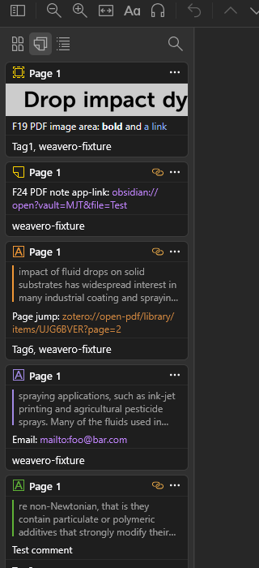
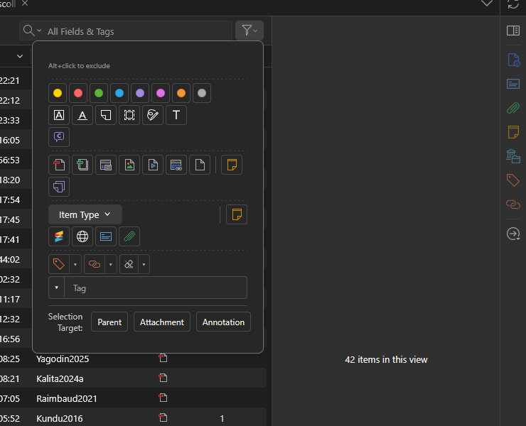
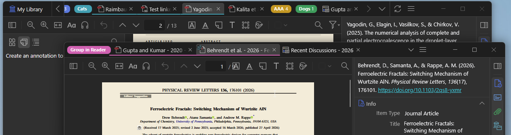

**Weavero** is a free, open-source plugin for [Zotero](https://www.zotero.org) (7 to 10-beta) that layers convenience features on top of the standard library and reader: **clickable links in annotation comments and notes**, a fast **filter pane**, **bookmarks**, related-item tools, a structured tabs menu, **tab groups and window management**, and extra items-tree columns. Every feature is individually toggleable in Preferences.

- 📦 **[Download the latest release](https://github.com/mjthoraval/Weavero/releases/latest)** (`weavero.xpi`)
- 💻 **[Source code on GitHub](https://github.com/mjthoraval/Weavero)** (AGPL-3.0, same license as Zotero)
- 🐛 **[Report an issue](https://github.com/mjthoraval/Weavero/issues)**

## Clickable links in annotations and notes

URLs, `zotero://` links, and optional app schemes (`obsidian://`, `vscode://`, and 15 more) become clickable in annotation comments and notes — across the items tree, item pane, reader sidebar, and in-PDF popups. Inline or icon-and-popup display, colour-coded by link kind, with inline markdown. Right-click menus add **Copy Item / Collection / Search Link** and **Copy Link to This Page / Location / Selected Text** in the reader — all standard `zotero://` links that work without the plugin.

**Interlinked navigation** — Ctrl/Cmd-click an internal PDF/EPUB/snapshot link to follow it in a split pane, or Shift+click to follow it in a coupled second window, without losing your place.

### Where a link opens

One meaning for each modifier wherever Weavero opens something — `zotero://` links in comments and notes, link chips, the Backlinks, Item Links and Related rows and their popups, bookmarks, internal links in a document, and the items list. ⌘ replaces Ctrl on macOS.

| | Click / Enter | Ctrl+click / Ctrl+Enter | Shift+click / Shift+Enter | Middle-click |
|---|---|---|---|---|
| **From a tab in a split view** | opens it (a tab, or a window when Zotero's *Open PDFs in a new window* is on) | **beside**: in the split's other side; the tab that was there stays open | a new window | a new tab in the background: nothing on screen changes (a note opens in front: Zotero's note opener has no background mode) |
| **With a tab locked on one side** (*Lock Tab*) | opens it; its tab shows beside the locked tab | **beside**: next to the locked tab (from either side); the locked tab stays | a new window | a new tab in the background |
| **Alone** | opens it | **beside**: a new split view of this tab and the target | a new window | a new tab in the background |
| **A link inside the same PDF, EPUB or snapshot** | jumps there | the document's second view (Zotero's split of one file) | a coupled second reader window | the document at that place, in a background tab |

Rows in lists keep their selection clicks (in the items list, Ctrl+click and Shift+click still select rows): use Ctrl+Enter (⌘+Return) there to open the selected item beside. Zotero's own Enter, Shift+Enter and double-click are unchanged, except for a note: Shift+Enter or Shift+double-click opens it the other way from *Settings → General → Open notes in new windows instead of tabs*, as Shift does for a PDF (Zotero opens a note window either way; [forum 128815](https://forums.zotero.org/discussion/128815)). A middle click on a note opens it in front: Zotero's note opener has no background mode. A web link opens in the browser whatever the modifier; Alt keeps its own meanings; on macOS, Control+click is the context menu.

## Filter your library and reader

A funnel next to the search box opens a filter popup: annotation colour/type/comment, attachment and item type, *Has DOI / URL / Related / Links*, and multi-select tag, publication, author, and collection facets — with include/exclude, OR groups, and a removable chip bar above the items tree. A matching funnel in the reader filters the open document's annotations. A second funnel beside the reader sidebar's search box filters the **annotations pane** the same way — colour, type, tag, comment, person, date — while the document keeps every annotation, so ink strokes can leave the pane and stay on the page. Per document, or as a default for all of them (Use as Default replaces the default, Alt+click adds to it). Zotero's own colour and tag selector at the foot of the pane folds to a **handle**: click the pill to expand or collapse it (one state for every document, kept across restarts; a selection made before folding stays in force and turns the pill blue). The library's Tag Selector gets the same handle on its top edge, and *View → Layout → Tag Selector* follows it. Each handle has its own switch in Settings; off, the selector is Zotero's again. The funnel itself can be switched off there; the pane then follows the types ticked in Settings. Two marks: a green line under the funnel, and under the chips the default sets, says a default other than "show everything" exists (those chips are shown in every document, even one with nothing of that kind); a blue dot on the funnel says this document departs from the default, with its own filter on top of it or after Clear. The footer names the default wherever the document departs from it.

## Bookmarks

Bookmark items, collections, searches, and URLs from a collections-pane dropdown — and in-document locations (positions, pages, text passages, annotations) from a Bookmarks tab in the reader sidebar. Folders, drag-and-drop, search, filtering, and hover previews. Right-click the Bookmarks tab to show or hide the “p. N” labels for that document, the way the Outline tab does.

## Reader outline

The reader's Outline tab becomes editable: rename entries, add your own (text selections, page anchors, pinned spots), drag to reorder or nest, and switch between the document's original outline and your curated **Weavero outline**. The outline also **highlights the section you're currently reading** as you scroll — embedded, extracted, and Weavero outlines alike — marking the deepest entry visible in your tree without ever expanding or collapsing it for you. Entries show their page number; right-click the Outline tab to hide the numbers for one document, or turn them off globally in Preferences. Works in PDFs, EPUBs (the book's table of contents, scrolled or paginated) and web snapshots (built from the page's headings).

## Tabs and windows

Pinned tabs, named colour-coded **tab groups**, multi-select tabs, and a structured "List all tabs" menu grouped by library with per-library and file-type filters. Reader tabs **move or tear off to another window with no reload** — scroll position, zoom, and selection preserved. Separate reader windows can show the full item-details pane.

## Extras

Items-tree columns for annotation / tag / related counts, an *Added By* badge for annotations in group libraries with per-user colours, a Firefox-style hidden title bar, *Open in External Viewer*, a Plugins Manager with a search box (Ctrl+F), cards showing author, GitHub owner, version and last update, a remembered time frame for Recent Updates, its sidebar back on Zotero 11, in a normal resizable window, a *View → Layout* menu that follows the tab (the reader's Sidebar, Context Pane and colour/tag selector in a reader tab, the library's panes in the library tab), and a PDF outline text highlight.

## Backups

Zotero's backups and sync do not include Weavero's own data (bookmarks, outlines, tab groups, sessions, feeds lists) or its settings, so Weavero keeps copies itself: once a day and before each update, in its data folder (`weavero/backups/`), the last 7 daily copies kept. *Settings → Weavero → Backups* backs up now, restores a copy after showing what would change (the current state is backed up first, so a restore can be undone), and exports or imports everything as one file. A restore is written when Zotero starts again, before Weavero reads its data. Details: the [README](https://github.com/mjthoraval/Weavero#backups-of-weaveros-data).

## Install

1. Download the latest `weavero.xpi` from the [Releases page](https://github.com/mjthoraval/Weavero/releases/latest).
2. In Zotero: `Tools → Plugins → ⚙ → Install Plugin From File…` → pick the XPI.
3. Restart Zotero if prompted.

Weavero is also listed in the community [Zotero Addons](https://github.com/syt2/zotero-addons) plugin store — if you have that plugin installed, search for "Weavero" there.

## Safety and compatibility

Weavero never writes to or modifies your PDF files or attachments — it only layers UI on top of Zotero's standard views and keeps its own data in separate files. It is developed and tested against Zotero 10.0-beta; a few features rely on Zotero 10 APIs and may be unavailable on Zotero 9. See the [README](https://github.com/mjthoraval/Weavero#readme) for full feature documentation, the [filtering rules](https://github.com/mjthoraval/Weavero/blob/main/docs/filter-rules.md) for the filter logic, [compatibility.md](compatibility.md) for feature-by-version status on Zotero 9 vs 10, **[Developing Zotero plugins with AI](developing-with-ai)** for the from-scratch guide, the Weavero workflow, and ecosystem resources (the workflow's instruction files themselves are [published in the repo](https://github.com/mjthoraval/Weavero/tree/main/.claude)), and [TESTING.md](https://github.com/mjthoraval/Weavero/blob/main/TESTING.md) for how Weavero is tested (including the [performance protocol](https://github.com/mjthoraval/Weavero/tree/main/bench) and the [Windows taskbar overlay findings](taskbar-overlay-testing.md), which may interest other plugin developers).
